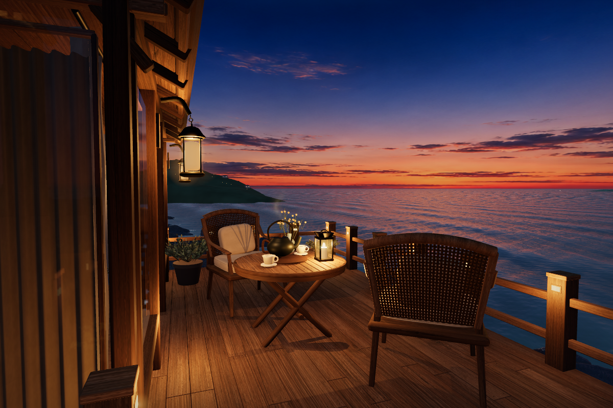

# 暮岸 · A quiet moment

一座临海木屋，两把藤椅，一壶热茶。太阳落下后，晚霞还映在海上，露台与卧室亮起暖灯。

《暮岸》是一个用 Three.js 搭建的可交互 3D 网页。可以沿着海岸看木屋、坐到露台上看海，也可以走进卧室，或从上方俯看整个布局。



## 打开项目

下载或解压项目后，用支持 WebGL 的 Chrome 或 Edge 打开根目录的 [index.html](index.html)。也可以单独取出 [暮岸.html](offline/%E6%9A%AE%E5%B2%B8.html) 打开。两种方式都可以离线运行。

## 五个视角

| 快捷键 | 视角 | 画面 |
| --- | --- | --- |
| `1` | 海岸全景 | 岩坡上的木屋、远岸灯火和潮水中的礁石 |
| `2` | 露台时光 · 默认 | 沿木墙望向圆桌、藤椅与晚霞 |
| `3` | 卧室与工作区 | 暖灯下的床品与紫蓝色电脑区 |
| `4` | 床边看海 | 透过窗框和帘子看露台与海平线 |
| `5` | 去屋顶俯视 | 暂时移开屋顶、天花和吊灯，查看室内与露台布局 |

[海岸全景](docs/previews/preview.png) · [卧室](docs/previews/preview-room.png) · [床边看海](docs/previews/preview-bedsea.png) · [俯视布局](docs/previews/preview-plan.png) · [近岸浪花](docs/previews/preview-shore.png)

拖动环顾，滚轮缩放，触屏支持单指环顾和双指缩放。空格暂停或恢复，`H` 隐藏界面，`M` 切换海浪声。声音默认关闭。设置面板可调天色、海风和画质。

## 场景实现

- **暮色与海浪** — 天空和海面共享晚霞方向。多组波浪叠加形成细碎倒影，泡沫沿礁石水线推进、破碎和退散。
- **木屋与露台** — 杉木覆面、双坡瓦顶、清透玻璃、暖色灯笼和立体藤编都能从不同角度观察。石阶、低矮岩脊和屋后林坡连接起陆地与海。
- **海景卧室** — 床品和家具是三维模型。床头暖灯、紫蓝电脑区、中央过道和通向露台的开口在五个视角中保持同一布局。
- **画质适配** — 自动、精细、均衡与流畅四档调整渲染分辨率、反射、阴影及后处理。记录包含 WebGL 1 和缺少浮点渲染附件时的回退测试。参见 [兼容性记录](COMPATIBILITY.md)。

## 源码结构

| 文件 | 用途 |
| --- | --- |
| `index.html` / `style.css` | 页面入口、菜单与响应式界面 |
| `scene.js` / `interior.js` | 木屋、露台、卧室、镜头、灯光与音效 |
| `ocean.js` / `terrain.js` | 波浪、岸线泡沫、岩岸和植被 |
| `quality.js` / `post.js` | 画质、图形能力检测和后处理 |
| `assets.js` / `softgoods.js` / `nature-assets.js` / `coast-assets.js` | 已内嵌的运行纹理和网格 |
| `assets/` / `models/` | 原始贴图、网页所用模型的制作源文件及来源记录 |
| `docs/previews/` / `offline/` | 实机截图与离线单文件 |

修改源码后，可以用 Node.js 重新打包单文件。脚本使用 Node.js 内置模块。

```sh
node scripts/build-offline.cjs
```

更多材质、坐标和渲染细节见 [技术说明](TECHNICAL.md)。

## 素材与许可

- Three.js 0.160.1 使用 MIT 许可，随项目附有 [许可证原文](vendor/LICENSE)。
- 两处扫描礁石和室内蕨类使用 Poly Haven 的 CC0 1.0 素材。作者、原件和转换方式见 [Coast Rocks 05](models/coast-rocks-05/README.md) 与 [Fern 02](models/fern-02/README.md)。
- 天空、岩石和木纹的生成记录见 [贴图记录](assets/GENERATED.md) 和 [杉木贴图记录](assets/TIMBER-PROMPT.md)。床品的制作源文件见 [软装说明](models/README.md)。

以上许可分别适用于所列组件与素材。
